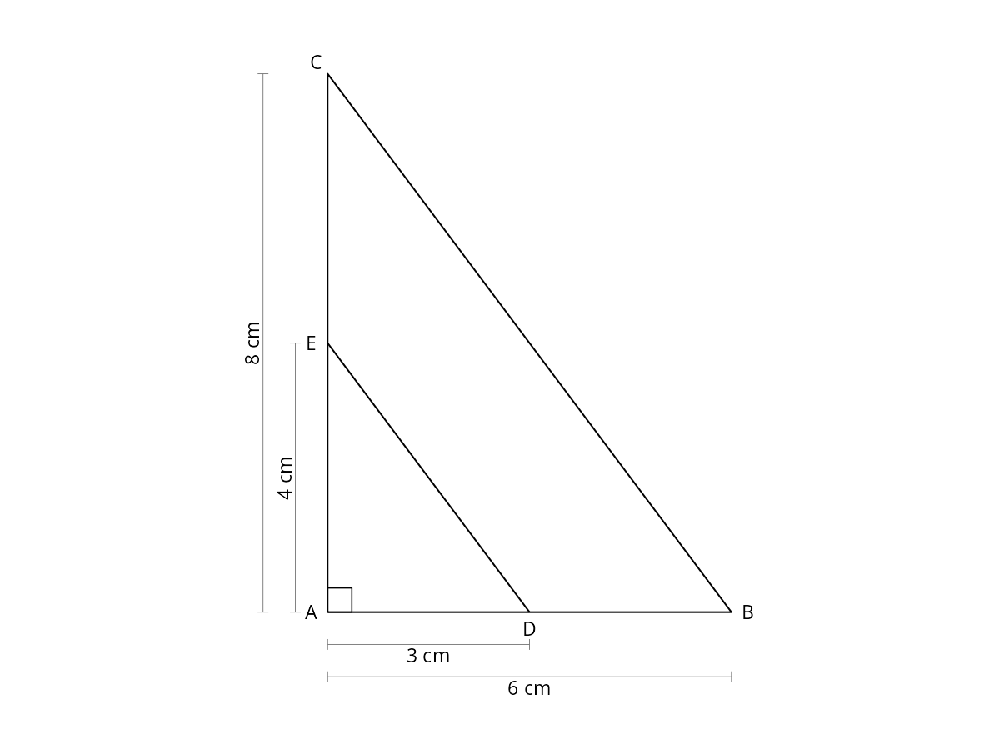

# Exercice 1

Le triangle ABC est rectangle en A.

Les points D et E appartiennent respectivement aux segments [AB] et [AC].

On donne AB = 6 cm, AC = 8 cm, AD = 3 cm et AE = 4 cm.

{width=9cm}

1. Calculer la longueur BC.

2. Demontrer que les droites (DE) et (BC) sont paralleles.

3. Calculer la longueur DE.

4. Calculer l'aire du quadrilatere DBCE.
